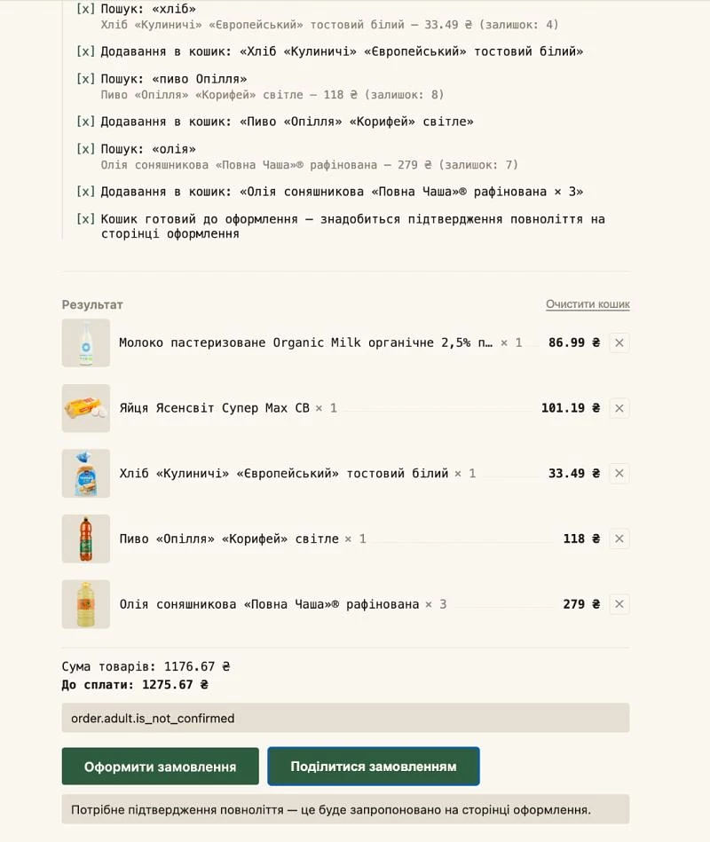
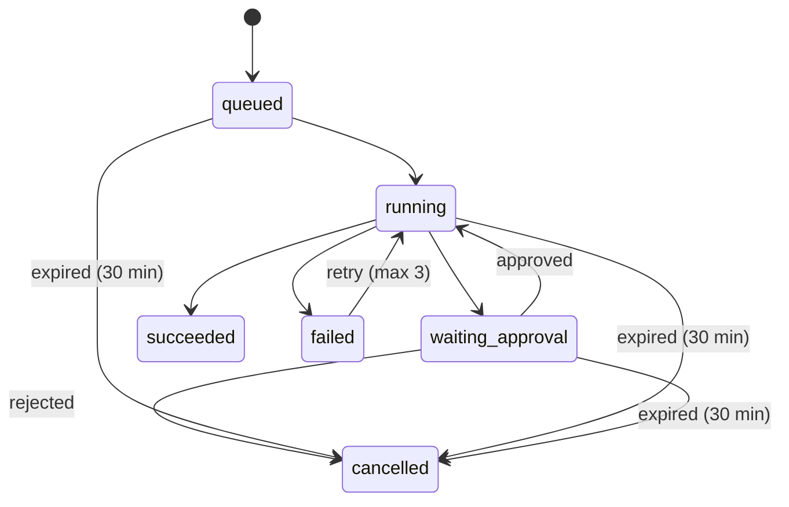
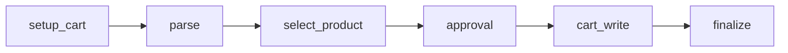

# Silpo Voice Shopping Agent

[Українська версія](README.uk.md)

Voice shopping agent for Silpo (a Ukrainian grocery chain): say what you need, and it parses the request into concrete items, searches Silpo's real catalog through their MCP server, builds a cart at a given address, and hands you off to checkout. Built for the Silpo AI Factory hackathon.

- **Live:** https://silpo-voice-shopping-agent.vercel.app
- **Article:** [dev.ua](https://dev.ua/news/holosovyi-ahent-dlia-zamovlennia-u-silpo-1789557254) (article in Ukrainian)
- **Demo video:** [YouTube](https://www.youtube.com/watch?v=W4zIgaQPTrM) (in Ukrainian, recorded for the hackathon — shows the version before the control plane: no approval step, the run is driven directly from the browser)



## Stack

Angular 21 (signals, standalone components, no HttpClient — plain `fetch`) + Vercel Edge Functions (TypeScript) + Upstash Redis + Anthropic Claude (Opus for query parsing, Haiku for relevance checks) + Web Speech API + Respeecher TTS. MCP client to `https://mcp.silpo.ua/mcp` built from scratch (OAuth 2.1 + PKCE + Dynamic Client Registration, no SDK).

The UI is currently Ukrainian-only.

## Architecture

The Angular UI (`src/app`) doesn't talk to Silpo directly — it drives a server-side run and renders whatever journal comes back:

```
Angular UI (src/app) ──fetch──> api/runs.ts, api/runs/[id]/{advance,approve,retry,index}.ts (Vercel Edge)
                                      │
                        lib/control-plane/{plan,execute,store}.ts
                                      │
                        lib/mcp/{oauth,client,silpo-tools}.ts
                                      │
                              mcp.silpo.ua/mcp (JSON-RPC / Streamable HTTP)

Upstash Redis:
  cp:run:*, cp:session:*:runs      — run journal (lib/control-plane/store.ts)
  mcp:client, mcp:tokens:*, mcp:session_id:*  — OAuth client + per-session tokens/MCP session
  ratelimit:*                      — per-IP limits on POST /api/runs (10/min) and
                                      POST /api/runs/[id]/advance (120/min), plus
                                      the older api/agent/* and api/tts/speak.ts
```

`POST /api/mcp/cart/items` and `POST /api/mcp/cart/clear` are also called directly by the client, outside the control plane, for actions that don't need a multi-step run: removing a single item, swapping in a discount alternative, and clearing the cart (`SilpoAgentService.removeProduct` / `switchToAlternative` / `clearCart`).

`api/agent/*`, `api/mcp/products/search.ts`, and `api/mcp/cart/create.ts` are still deployed but no longer called by the UI — the parsing/search/relevance logic they used to front now lives in `lib/agent/*-core.ts` and is called directly by both the control plane (`lib/control-plane/execute.ts`) and the eval harness (`evals/runner.ts`).

### Run status



The three `expired` transitions are the same check (`findResumableRun`, `lib/control-plane/store.ts`): any non-terminal run older than 30 minutes is marked `cancelled` with `error: 'expired'`, regardless of which non-terminal status it was found in.

### Steps per run



`select_product` and `cart_write` each run once per recognized item (`lib/control-plane/types.ts`: `StepKind`).

## Control plane

- **Run + journal** (`lib/control-plane/types.ts`). A `Run` is a row in Redis; its `Step[]` journal is append-only — each entry records `input` (the `PlanDecision` it executed), `output`, `toolCalls` (name/success/duration of every downstream call), `llm` (model + token counts, for steps that call Anthropic), `attempt`, and `error`/`errorCode`.
- **One step per `POST /api/runs/[id]/advance` call.** Vercel Edge Functions have an execution time limit, and this makes recovery from an interrupted call trivial: resuming is just another call to `advance` — there's no separate "resume" code path, `planNext` (`lib/control-plane/plan.ts`) just re-derives the same decision from the journal.
- **Approval gate** (`plan.ts` → `kind: 'approval'`, `api/runs/[id]/approve.ts`): once every item has been searched, the run pauses in `waiting_approval` until the person confirms or drops individual finds — nothing is written to the cart before that.
- **Resume after reload**: `GET /api/runs` → `findResumableRun` (`lib/control-plane/store.ts`) returns the session's most recent non-terminal run, if any, under 30 minutes old; `SilpoAgentService.resumeIfAny()` calls this once on startup and picks the run back up.
- **Retries**: a network error or 502/503/504 from `advance()` gets up to 3 client-side retries with backoff (500ms/1s/2s — `SilpoAgentService.postWithRetry`); a run that lands in `failed` gets a "Retry" button (`POST /api/runs/[id]/retry`), capped at 3 attempts per `(kind, itemKey)`.

## Engineering decisions

- **A hand-rolled orchestrator, not LangGraph or similar.** I wanted the recovery mechanism itself to be inspectable: `planNext` (`lib/control-plane/plan.ts`) is a pure function over the journal — given the same journal, it always returns the same next decision — not a library's internal state machine.
- **Idempotency without an idempotency key, since Silpo's API doesn't have one.** `cart_write` (`lib/control-plane/execute.ts`) sets the quantity rather than adding to it (`addQuantity: false`), and reads the live cart before acting: if the picked product is already there at the right quantity, it does nothing; if it's a replace and the target is already gone (removed by an earlier, interrupted attempt), it doesn't fail — it just proceeds to add the new item.
- **Distributed lock in Redis** (`lib/redis-lock.ts`): `acquireLock` stores a random token; release and conditional writes go through Lua scripts that only act while that same token is still the value stored — a compare-and-swap guard, not a monotonic fencing token, but the same goal: a lock past its TTL can't be used to clobber someone else's write. The HTTP timeout for calls to Silpo's token endpoint (`UPSTREAM_FETCH_TIMEOUT_MS = 10s`, `lib/mcp/oauth.ts`) is deliberately shorter than both the registration and refresh lock TTLs (30s/15s) — a hung upstream call can't outlive the lock it's running under.
- **A check-then-act race found on review**: in `POST /api/runs/[id]/advance`, the journal used to be read before the lock was acquired — a concurrent call could append a step while the first was still waiting for the lock, so planning against the stale copy risked re-executing a step that had just completed. Fixed by re-reading the journal after acquiring the lock and planning against that copy only.
- **OAuth** (`lib/mcp/oauth.ts`): `ensureValidAccessToken` serializes refreshes behind a per-session Redis lock — concurrent callers poll for the winner's result instead of refreshing the same token twice. `invalid_client`/`invalid_grant` from the token endpoint throw `ReauthRequiredError` (forces the person back through `/api/mcp/auth/login`); any other failure (5xx, network) leaves the stored tokens alone, since it's presumed transient. The tokens key gets a 90-day Redis TTL because Silpo's own access tokens run ~30 days (confirmed from live `expires_in` values) — the refresh token's actual lifetime isn't documented anywhere, so 90 days is a margin, not a verified fact.
- **Fault injection for testing recovery** (`FAULT_INJECTION_SECRET` + the `x-fault-inject` header, `api/runs/[id]/advance.ts`): when both are set and match, `advance` throws right after the step's real work finishes and before it's written to the journal — simulating a process crash at the one point where recovery actually matters, without waiting for a real one. See below for how to reproduce it.

## How to reproduce the crash-recovery demo

Entirely from the browser console on the production site (same session cookie), **not** through the UI — if the UI is also running, it will call `advance()` on its own and either execute `cart_write` first or collide with this script's own call on the run's lock. Requires `FAULT_INJECTION_SECRET` set in Vercel Production.

```js
// 0. Clean slate.
await fetch('/api/mcp/cart/clear', { method: 'POST' });

// 1. Create a run.
const { run } = await (await fetch('/api/runs', {
  method: 'POST',
  headers: { 'Content-Type': 'application/json' },
  body: JSON.stringify({ address: '<your address>', request: 'молоко' }),
})).json();
const runId = run.id;

// 2. Advance until it pauses for approval.
let current;
do {
  current = await (await fetch(`/api/runs/${runId}/advance`, { method: 'POST' })).json();
  console.log(current.run.status, current.next?.kind);
} while (current.run.status !== 'waiting_approval');

// 3. Approve everything found.
const approved = await (await fetch(`/api/runs/${runId}/approve`, {
  method: 'POST',
  headers: { 'Content-Type': 'application/json' },
  body: JSON.stringify({
    approved: true,
    approvedItemKeys: current.next.items.map((i) => i.itemKey),
  }),
})).json();
console.log(approved.run.status); // 'running' — next step is cart_write

// 4. "Kill the process" right between the real Silpo call and the journal write.
const crashed = await fetch(`/api/runs/${runId}/advance`, {
  method: 'POST',
  headers: { 'x-fault-inject': '<FAULT_INJECTION_SECRET>' },
});
console.log(crashed.status); // 502

// 5. Reload the page now — SilpoAgentService.resumeIfAny() finds this same
//    run (still 'running', under 30 minutes old) and keeps driving it, no
//    manual action needed.

// 6. After the reload, inspect the journal:
const state = await (await fetch(`/api/runs/${runId}`)).json();
console.log(state.steps.filter((s) => s.kind === 'cart_write'));
```

What this actually shows (stated precisely, not stronger):
- The journal has exactly **one** `cart_write` step, not two — the crashed attempt from step 4 never reached `appendStep`, so it leaves no entry at all.
- That one step's `toolCalls` list only `getMyShoppingCart` and `getShoppingCartById` — no `addOrUpdateCartProducts` — the idempotent check in `execute.ts` saw the product already in the cart and skipped writing it again.
- The cart itself shows the product at `quantity: 1`, not 2.

This does **not** show the journal recording that the Silpo call happened before the crash — that call (step 4) never makes it into the journal at all. The evidence that it happened is indirect: the product is already in the cart, which is exactly why the retry doesn't write it again.

## Evals

33 cases in `evals/cases/`, run with `npm run eval`. Query parsing and relevance checking are live Anthropic calls, not mocked, so running the suite costs real API usage; product-search candidates come from a frozen fixture (not a live MCP call), so a case doesn't break when a product falls out of the catalog. There's no built-in cost tracking — the suite's actual token cost isn't reported anywhere.

## Known limitations

- A run is driven by the client, not a queue or background worker. Closing the tab pauses it until the next time the page opens (up to 30 minutes — see `findResumableRun`), it isn't lost.
- The price shown on the approval panel is from when the item was searched; it can change by the time `cart_write` actually runs — there's no re-check against a fresh price.
- Silpo's refresh-token lifetime isn't documented. The 90-day Redis TTL on stored tokens is an assumption, not a confirmed fact.
- Tokens are stored in Redis without application-level encryption (relies on Upstash's own transport security and project isolation).
- `failed` runs aren't included in `findResumableRun` — after a page reload they just disappear from the UI, along with the "Retry" button.
- `verifyBranchIsHealthy` (`lib/mcp/silpo-tools.ts`) is a heuristic — a control search for "молоко" with a non-zero result — not a guarantee, and has only been exercised against branches in Lviv.
- The UI is Ukrainian-only (there's an English intro block for non-Ukrainian browsers, nothing more).

## Local development / tests

```bash
npm install
npm start         # ng serve, http://localhost:4200
npm run test:lib  # vitest, lib/**/*.spec.ts
npm test          # ng test
npm run eval      # evals/runner.ts — live Anthropic calls
npm run build
```

`proxy.conf.json` sends `/api` to `https://silpo-voice-shopping-agent.vercel.app` (production) — the Redis/MCP/Anthropic/Respeecher secrets aren't available locally, so `ng serve` always proxies `/api` calls to the deployed backend. The config key is the bare prefix `"/api"`, not a glob like `"/api/*"` — Angular 21's dev server runs on Vite, and the old webpack-style glob prefix silently matches nothing there.

Angular CLI (`ng generate component ...` etc.) is standard — see the [official docs](https://angular.dev/tools/cli).
